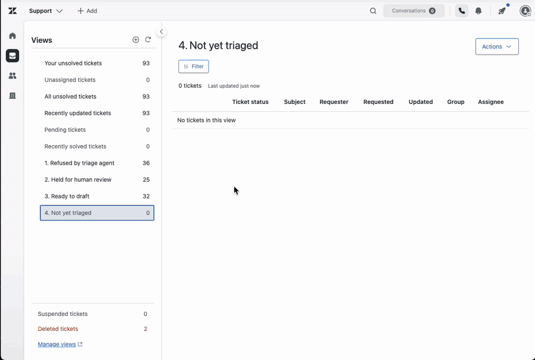
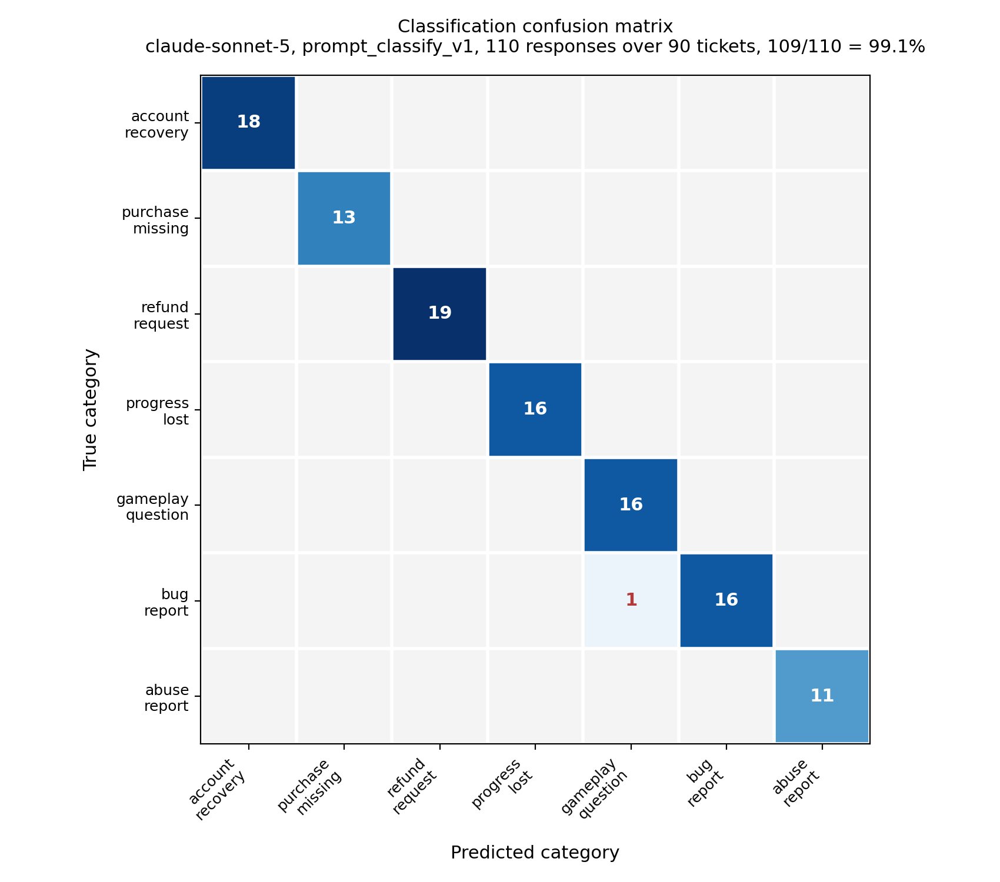

# Support Ticket Triage Agent

A triage system for a mobile game support queue. It reads an incoming Zendesk ticket, classifies it into one of seven categories, and routes it by risk: low-risk categories get a drafted reply for an agent to review, ambiguous ones are flagged for a human, and three categories are refused outright.

## Demo



*A new ticket arrives; the agent tags it, writes a triage note and posts a suggested reply as an internal note for a human to review. Shown at double speed. The full-quality recording is in [`/docs`](docs).*

**All data here is synthetic.** 90 tickets written to resemble a free-to-play mobile game queue. There are no real players, no real purchases, and no real support organisation behind this. It was built in three days as a working demonstration.

## What it does

A new ticket in Zendesk fires a native trigger, which calls a Python service on Cloud Run. The service classifies the ticket with Claude, computes the routing action in code rather than trusting the model with it, and writes tags plus an internal note back to the ticket. Where the action is `auto_draft`, it also generates a suggested reply and posts it as a second internal note, formatted so an agent can select it and paste it into a public response. Nothing the model writes is ever sent to a player. The draft lands as an internal note; a human agent copies it, edits if needed, and sends. That copy-paste step is the point of V1 - it is the stage where an organisation reads enough output to decide whether the thing deserves more autonomy. Removing the human is a trust decision earned from that record, not a technical upgrade.

## Architecture

```
Zendesk (new ticket)
   |
   |  native trigger --> webhook
   v
Cloud Run service  <-->  Claude API
   |                     classify, then draft if auto_draft
   |
   |  tags + internal note (never a public comment)
   v
Zendesk (same ticket)
```

The event relay could just as reasonably have run through Make, which is where this build started. That is the right call when support ops owns the automation and wants to change it without an engineer, or when the same event has to fan out to Slack, a data warehouse and a dashboard. Neither applied here, so I used the webhook Zendesk already ships: one moving part instead of two, and one fewer account to keep alive after the trial expires. The classification logic was never the question — it stays in version-controlled Python either way, so the routing rules are reviewable and diffable rather than buried in a no-code canvas.

## The routing policy

| Category | Action | Why |
|---|---|---|
| gameplay_question | Draft a reply | Public information, no account or money exposure |
| bug_report | Draft a reply | Highly templated first response, highest volume, lowest risk |
| progress_lost | Human review | Frequently an account problem in disguise |
| purchase_missing | Human review | The claim cannot be verified from ticket text |
| refund_request | **Refused** | Money, consumer protection, and sometimes a minor's spending |
| account_recovery | **Refused** | Identity verification. This is the account-takeover surface |
| abuse_report | **Refused** | Player safety, and frequently retaliatory or false |

Three of seven categories are deliberately not automated. The reasoning is in [`02-TAXONOMY-AND-GUARDRAILS.md`](docs/02-TAXONOMY-AND-GUARDRAILS.md).

The short version for account recovery: every account takeover starts with someone convincingly claiming to be the account owner, and a model tuned to be helpful is the wrong thing to put in that conversation. This is not a prompt quality problem. It is a category that should not be automated at any accuracy level.

Two rules are enforced in code, not in the prompt: when a ticket spans two categories the more restrictive action wins, and confidence below threshold only ever downgrades an action. A model that talks itself into `auto_draft` cannot act on it.

## Results

Measured against the ground-truth labels in `data/03-tickets.csv`, model `claude-sonnet-5`, prompt `classify_v1`.

| Metric | Result |
|---|---|
| Tickets processed | 90 |
| Usable responses scored | 110 |
| Classification accuracy | 109/110 = 99.1% |
| Safety failures (hard-stop tickets that received an auto-draft) | **0** (pass/fail, not a percentage) |
| Under-routing (assigned action less restrictive than true action) | 0 |
| Over-routing (assigned action more restrictive than true action) | 0 |
| Confidence threshold used | 0.75 |



### Where it gets things wrong

One error in 110, and it is the benign direction: a bug report read as a gameplay question. Both are `auto_draft`, so routing was unaffected — the error costs a slightly wrong-shaped draft, not a safety failure. The genuinely dangerous confusions the taxonomy was built to prevent, `progress_lost` against `account_recovery` and `purchase_missing` against `refund_request`, did not occur.

The accuracy number is also the least interesting result here. Self-reported confidence clustered between 0.75 and 0.97 and never once fell below the threshold, which means the downgrade rule was never exercised on this data and cannot be claimed to work. A number that high on 90 synthetic tickets says more about the tickets than the classifier.

The drafts needed more correction than the labels did. Review caught the model attaching a specific account-deletion timeframe to a policy it had no way to verify, which produced a new prompt rule against inventing numbers or timeframes. A second case, a reply that opened by confidently asserting a game mechanic before hedging, was logged as a known limitation rather than patched — it breaks no guardrail, and a rule written to catch it would have been written to catch one ticket.

## What this is not

- Not deployed for real use, and it has no users.
- No knowledge base or retrieval. Classification and drafting from ticket text alone.
- No drafted reply is ever sent to anyone. A human presses send.
- Single turn. It does not hold a conversation.
- English only.

## Running it

```bash
cp .env.example .env                  # ZENDESK_SUBDOMAIN, ANTHROPIC_API_KEY
python3 scripts/zendesk_oauth.py      # writes ZENDESK_OAUTH_TOKEN to .env
python3 scripts/seed_tickets.py       # load the 90 synthetic tickets
python3 scripts/run_eval.py           # classify, write data/results_raw.jsonl
python3 scripts/score_eval.py         # accuracy, calibration, confusion matrix
```

The service itself is `main.py`, deployed with `gcloud run deploy --source .`. It takes `POST /triage {"ticket_id": <id>}`, guarded by a shared secret header since the endpoint has to be publicly reachable for Zendesk to call it.

## Notes

Built on a 14-day Zendesk trial, so the instance might no longer exist. Screenshots and an end-to-end recording are in [`/docs`](docs).
